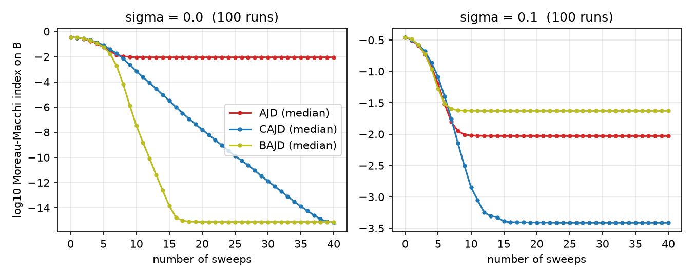

# cajd — Composite Approximate Joint Diagonalization for EEG / ERP

Python reimplementation, written from scratch, of **Composite Approximate Joint Diagonalization (CAJD)**. It is a blind source separation method for EEG that models two kinds of sources at once:

- **ongoing** activity with a **linear** model (covariances, co-spectra): `C_l = A Λ_l Aᵀ`;
- **evoked** activity (ERPs) with a **bilinear** spatio-temporal model: `X_k = A S_k Eᵀ`.

Both models share the same spatial mixing matrix `A`.

> Korczowski, Bouchard, Jutten, Congedo. *Mining the Bilinear Structure of Data with Approximate Joint Diagonalization*. EUSIPCO 2016, pp. 667–671. [hal-01357245](https://hal.science/hal-01357245)
> Original MATLAB code: [composite-joint-diagonalization-matlab](https://github.com/lkorczowski/composite-joint-diagonalization-matlab)
> Latency correction ported from ACSTP: [Python package](https://github.com/lkorczowski/adaptive-common-spatio-temporal-pattern) · [MATLAB](https://github.com/lkorczowski/adaptive-common-spatio-temporal-pattern-matlab)

**Keywords:** EEG · ERP · P300 · BCI · blind source separation · approximate joint diagonalization · tensor / CP decomposition · single-trial ERP estimation · denoising · scikit-learn · MNE · MOABB · pyRiemann

## Install

```bash
pip install -e .            # numpy, scipy, scikit-learn
pip install -e ".[eeg]"     # + mne, moabb, pyriemann
pip install -e ".[dev]"     # + pytest, matplotlib
```

## Quick start

```python
from cajd import CAJD
from cajd.simulation import simulate_erp_eeg

sim = simulate_erp_eeg(n_channels=16, n_epochs=200, snr_db=-5, random_state=0)

est = CAJD(alpha=0.5, linear="covariances", random_state=0).fit(sim.X, sim.y)
est.patterns_              # (n_channels, P)  scalp maps, sorted by evoked power
est.temporal_patterns_     # (P, n_times)     source waveforms
sources = est.transform(sim.X)                                 # B.T @ X_k
clean = est.denoise(sim.X, components=[0, 1], mode="bilinear")  # A_i S_k(i) E_iᵀ
```

`X` is an array `(n_epochs, n_channels, n_times)` or an `mne.Epochs` (then `sfreq` is read from `info`). The estimators follow the scikit-learn API (`fit` / `transform`, `get_params`, `clone`), so they drop into `Pipeline`s, MOABB evaluations and pyRiemann pipelines:

```python
from sklearn.pipeline import make_pipeline
from pyriemann.estimation import Covariances
from pyriemann.tangentspace import TangentSpace
from sklearn.linear_model import LogisticRegression

pipe = make_pipeline(CAJD(n_components=4, linear="covariances"),
                     Covariances("oas"), TangentSpace(), LogisticRegression())
```

## API

| Object | What it does |
|---|---|
| `CAJD(alpha=0.5, linear=..., bilinear=..., n_components=None, ...)` | Composite AJD. `alpha` weighs the linear term; both sets are first scaled to unit energy. |
| `BAJD(...)` | Bilinear only (`alpha=0`). |
| `AJD(...)` | Linear only (`alpha=1`). |
| `gpt(X, C, B0, D0, alpha)` / `ajd_gpt` / `bajd_gpt` / `cajd_gpt` | Low-level Gauss-planar-transformation solvers on matrix sets. |
| `svd_init(X)` | Initialization from the SVD of the average trial (paper eq. 9–10). |
| `estimate_latencies`, `shift_epochs` | Single-trial latency estimation of ACSTP (Congedo et al., 2016): leave-one-out average, filtered cross-correlation, peak closest to zero. |
| `cospectra`, `covariances`, `bootstrap_averages` | Build the linear and bilinear target sets. |
| `moreau_macchi`, `snr_db`, `correlation` | Separation and ERP-quality metrics. |
| `cajd.simulation.simulate_paper` | The paper's matrix-level simulation. |
| `cajd.simulation.simulate_erp_eeg` | Random ERPs in random ongoing EEG (oscillations + 1/f), shared `A`, optional latency jitter. |

Main options of `CAJD`:

- **`bilinear`**:
  - `'averages'` (default): bootstrapped ensemble averages per class, as in the paper;
  - `'epochs'`: raw epochs, which makes CAJD unsupervised.
- **`linear`**:
  - `'cospectra'` (paper, needs `sfreq`);
  - `'covariances'` (per-epoch covariances, which exploit non-stationarity);
  - `'cospectra+evoked'`.
- **`n_components`**: number of sources P ≤ n_channels.
- **`init`**: `'svd'` or `'identity'`.
- **`max_shift`** (samples, default 0 = off): jitter-tolerant CAJD. Target trials are realigned on their ACSTP latency estimate, the model is refitted on the realigned epochs (`latency_refits` times), and `denoise`/`amplitudes` realign new trials and shift the bilinear reconstruction back. `latencies_` holds the training latencies.

### Differences from the MATLAB code

- **α is explicit:** the cost is α·Σ‖off(BᵀC_lB)‖² + (1−α)·Σ‖off(BᵀX_kD)‖². β follows the paper's closed form, including the factor 2α.
- **Normalization:** each sweep normalizes the columns of B and D to unit norm (this doesn't change the path, but prevents drift), and the two sets are scaled to unit energy before fitting.
- **Optional ground truth:** the true `A`/`E` are not needed. Track any metric with `callback`.
- **P < N sources** are supported.
- **Reduced temporal basis (`reduce_time=True`, default in the estimators).** The 2016 algorithm updates the T×P temporal unmixing D with planar shears, which crawls when T ≫ N: from the paper's initialization it can stall for thousands of sweeps. Writing D = V·D̃, with V (T×N) the N leading right singular vectors of all observations stacked and D̃ (N×N) the only unknown, converges to exact separation in a few hundred sweeps and is 10–16× more accurate on D under noise. `gpt(..., d_step='exact')` also replaces the γ shears by the closed-form optimum of each column of D. `reduce_time=False` reproduces the 2016 algorithm.

## Validation

```bash
pytest                                   # 21 tests, including exact recovery on noiseless data
python experiments/paper_fig2.py 100     # reproduces the paper's Fig. 2 / Table I
python experiments/synthetic_snr.py 10   # hypothesis test: ERP in simulated EEG
```

Reproduction of the paper's simulation (100 runs, N = 16, non-orthogonal `A` and `E`; Moreau-Macchi index on `B`, median):

| noise σ | AJD | BAJD | CAJD |
|---|---|---|---|
| 0 | 8.9e-3 | 7.6e-16 | 6.5e-16 |
| 0.1 | 9.3e-3 | 2.3e-2 | **3.9e-4** |



## Status

Research code (0.1.0.dev0), developed alongside a journal article in preparation. First synthetic results (`experiments/synthetic_snr.py`) show that CAJD does not beat xDAWN as a single-trial denoiser when ERP sources switch on and off between classes; the conditions under which the composite model helps are being studied.

## License

BSD-3-Clause (the MATLAB reference code is GPL-3.0).
